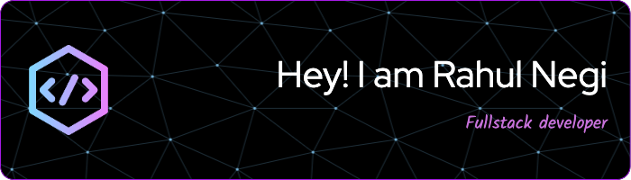

  

  
  
  
  

<h1 align="center">Hi, I'm Rahul Negi 👋</h1>

  Computer Science undergraduate at SRM University, interested in full-stack development,
  AI-powered applications, and cloud technologies.

- 🎓 B.Tech in Computer Science and Engineering, SRM University — CGPA: 9.05/10
- 💼 Front-end development experience with Team Envision
- 🌱 Currently building my skills in software development and cloud technologies
- 📜 AWS Certified Cloud Practitioner and AWS Certified AI Practitioner
- 📫 [Email me](mailto:rahulnegi0465@gmail.com)

## Tech Stack

  

## GitHub

